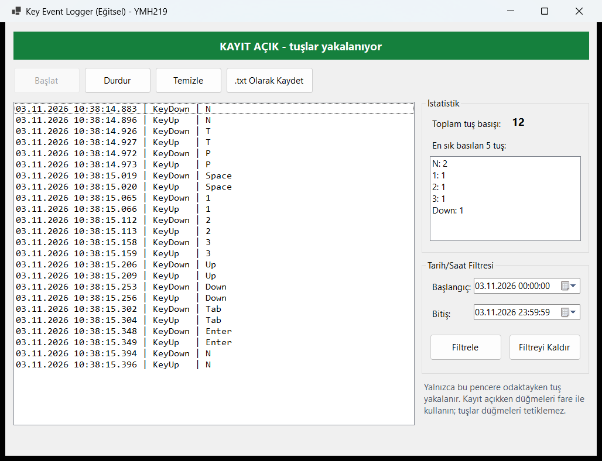
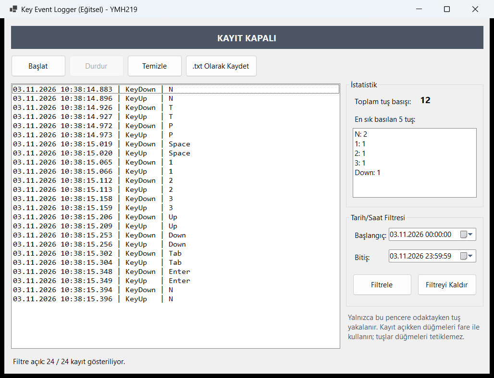

# Key Event Logger (Eğitsel)

Klavye olaylarının Windows Forms'ta nasıl yakalandığını ve işlendiğini gösteren eğitsel bir uygulama. Yalnızca **kendi penceresi odaktayken** basılan tuşları listeler ve kullanıcı isterse yerel bir metin dosyasına kaydeder.

YMH 219 Nesne Tabanlı Programlama dersi uygulama ödevidir.

## Kapsam ve Güvenlik Sınırı

Bu uygulama gerçek bir sistem keylogger'ı **değildir**:

- Yalnızca formun kendi `KeyDown` / `KeyUp` olaylarını kullanır; global klavye kancası yoktur.
- Pencere odakta değilken hiçbir tuş yakalanmaz ve arayüz bunu açıkça gösterir.
- Gizli veya arka plan çalışması, başlangıçta otomatik açılma yoktur.
- Parola/kimlik bilgisi toplamaz, başka uygulamalardan veri almaz.
- Ağ kullanmaz; dosyaya yalnızca kullanıcı **Kaydet** dediğinde ve seçtiği konuma yazar.

## Kullanılan Teknolojiler

- C# / .NET 9
- Windows Forms (`KeyDown`, `KeyUp`, `PreviewKeyDown`, `KeyPreview`, `ListBox`, `DateTimePicker`)
- `StreamWriter` ile dosya işlemleri
- Harici NuGet paketi yoktur.

## Kurulum ve Çalıştırma

Gereksinim: Windows ve [.NET 9 SDK](https://dotnet.microsoft.com/download/dotnet/9.0) veya Visual Studio 2022.

**Visual Studio ile:** `YMH219-KeyEventLogger.sln` dosyasını açıp `F5` tuşuna basın.

**Komut satırından:**

```
dotnet run --project KeyEventLogger
```

## Temel Özellikler

- Basılan tuşun adı, olay türü ve milisaniyeli zaman bilgisi `ListBox` üzerinde listelenir.
- **Başlat** ve **Durdur** ile kayıt kontrolü, **Temizle** ile ekrandaki kayıtları silme.
- Kayıtları `.txt` dosyasına kaydetme.
- Renkli kayıt durumu göstergesi: kapalı / açık / açık ama pencere odakta değil.
- Toplam tuş sayısı ve en sık basılan 5 tuş istatistiği (basılı tutma tekrarları sayılmaz).
- Kayıtları tarih/saat aralığına göre filtreleme.

## Ekran Görüntüleri





## Sınıf Tasarımı

| Sınıf | Görevi |
| --- | --- |
| `KeyEventRecord` | Tek bir klavye olayının değişmez kaydı ve satır biçimi |
| `KeyEventLog` | Kayıt durumu, olay listesi, filtreleme ve istatistik |
| `KeyLogFileWriter` | Kayıtların `.txt` dosyasına yazılması |
| `MainForm` | Klavye olaylarının yakalanması ve arayüz |

## Bilinen Sınırlamalar ve Geliştirme Notları

- Yön tuşları, `Tab` ve `Enter` normalde odak değiştirdiği için `KeyDown` olayına ulaşmaz. Kayıt açıkken `PreviewKeyDown` içinde `IsInputKey = true` yapılarak bu tuşlar da yakalanır.
- Bu nedenle kayıt açıkken klavyeyle düğmeler arasında gezilemez; **Durdur** fare ile kullanılır.
- `Alt` kombinasyonları engellenmez (`Alt+F4` çalışır).
- Kayıtlar yalnızca bellektedir; kaydedilmezse uygulama kapanınca silinir.
- Yalnızca Windows'ta çalışır.

## Öğrenci

- **Ad Soyad:** Samet Sel
- **Öğrenci No:** `BURAYA-OGRENCI-NUMARASI`
